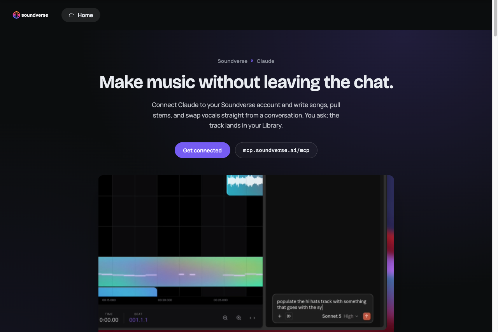

<div align="center">

<picture>
  <source media="(prefers-color-scheme: dark)" srcset="assets/soundverse-logo-dark.png">
  
</picture>

# Soundverse MCP Server

**Make AI music without leaving the chat.** The official Soundverse Model Context Protocol (MCP) server for Claude and other AI agents.

[](https://www.soundverse.ai/mcp)
[](https://www.youtube.com/@SoundverseAI)
[](https://www.linkedin.com/company/soundverseai)
[](https://x.com/soundverse_ai)

</div>

<p align="center">
The Soundverse MCP server connects <a href="https://claude.ai">Claude</a> and other MCP clients to <a href="https://www.soundverse.ai">Soundverse</a>, the AI music platform. From a conversation you can write and generate full songs with vocals, make instrumentals, pull stems, clone and swap voices, extend and remix tracks, and more. You ask, and the finished track lands in your Soundverse Library.
</p>

> [!IMPORTANT]
> **Consumer accounts only.** The MCP server works with Soundverse consumer accounts (Free, Creator, Pro and Max). It doesn't support Enterprise API accounts yet. For enterprise access, use the [Soundverse Enterprise API](https://www.soundverse.ai/docs).

## Contents

- [Quickstart with Claude](#quickstart-with-claude)
- [Video tutorials](#video-tutorials)
- [Example usage](#example-usage)
- [What Soundverse can do](#what-soundverse-can-do)
- [How it works](#how-it-works)
- [Permissions](#permissions)
- [Other MCP clients](#other-mcp-clients)
- [Troubleshooting](#troubleshooting)
- [FAQ](#faq)

## Server details

| | |
|---|---|
| **Server URL** | `https://mcp.soundverse.ai/mcp` |
| **Transport** | Streamable HTTP (remote server, nothing to install) |
| **Authentication** | OAuth 2.0 with your Soundverse account |
| **OAuth Client ID** | `jt7cp9hv4m9idkuyv2gt0` (public, with no client secret) |
| **Accounts** | Soundverse consumer accounts: Free, Creator, Pro, Max |
| **Billing** | Your Soundverse plan's tokens |
| **Output** | Your [Soundverse Library](https://www.soundverse.ai/studio) |

## Quickstart with Claude

You need a Soundverse account. It's [free to start](https://www.soundverse.ai).

1. In Claude, go to **Settings → Connectors**, click **Add**, then **Add custom connector**.
2. Name it **Soundverse** and paste in the server URL:
   ```
   https://mcp.soundverse.ai/mcp
   ```
3. On the next screen, choose **Use your own OAuth client** and paste this Client ID. **Leave the secret blank**, because there isn't one.
   ```
   jt7cp9hv4m9idkuyv2gt0
   ```
4. Click **Connect** and sign in with your Soundverse account.

That's it. Soundverse now shows up in your connectors list, and you can ask Claude for music.

<p align="center">
  
</p>

## Video tutorials

<table>
  <tr>
    <td align="center" width="50%">
      <a href="https://www.youtube.com/watch?v=BnMLW8ndAnk"></a><br>
      <b>Soundverse MCP: Make Songs With Claude</b><br>Full setup tutorial
    </td>
    <td align="center" width="50%">
      <a href="https://www.youtube.com/watch?v=bl7DMobXytI"></a><br>
      <b>Soundverse AI for Claude</b><br>Make music inside Claude with the AI music MCP
    </td>
  </tr>
</table>

## Example usage

> [!NOTE]
> Generations use tokens from your Soundverse plan, just like in the app.

Try asking Claude:

- "Write and generate an upbeat pop song about a road trip."
- "Turn this hum into a full song." *(attach the audio)*
- "Swap the vocals on this track for something warmer."
- "Pull the stems from this song."
- "Make a 30-second lo-fi instrumental for a study video."
- "Extend this track by another chorus, then remix it as drum and bass."

Claude tells you in the chat when the track is done. The track itself lives in your [Soundverse Library](https://www.soundverse.ai/studio), where you can listen, download, or keep editing in AI Studio. It doesn't play inside the conversation.

## What Soundverse can do

| Capability | What it does |
|---|---|
| **Song generation** | Full songs with vocals and lyrics, from a prompt, a melody, a hum or MIDI |
| **Music generation** | Instrumentals and background music in any genre, tempo and mood |
| **Singing generation** | Sung vocals from your lyrics |
| **Lyrics** | Write or rewrite lyrics in any style |
| **Extend and remix** | Lengthen a track, or reimagine it in another genre |
| **Voice cloning and swap** | Consent-based voice models, and swapping the voice on a track |
| **Audio inpainting** | Regenerate one section of a track |
| **Stem separation** | Split a song into vocals, drums, bass and instruments |
| **Transcription and audio-to-prompt** | Transcribe audio, or describe a track as a prompt |
| **Sound effects and video-to-SFX** | Generate sound effects, or score a video with matching effects |
| **Copyright recognition** | Similarity checks for AI and uploaded music |

The tool list is synced live from Soundverse, so new Soundverse tools appear in Claude automatically, with no update on your side.

## How it works

- **Remote and hosted.** There's nothing to install or run locally. Claude connects to `https://mcp.soundverse.ai/mcp` over Streamable HTTP.
- **Your account, your plan.** You sign in with OAuth, and every call runs as your Soundverse user, with your plan's models, licenses and limits.
- **Fair token billing.** Tokens are reserved when a generation starts and settled when it finishes. If a generation fails, the reserved tokens are returned.
- **Long generations don't time out.** Songs can take a while. If one runs past the call's wait window, the tool returns a `task_id`, and Claude checks back with the built-in `get_generation_result` tool until the track is ready.
- **Live progress.** Generation progress streams back to Claude as MCP progress updates.
- **Licensing by plan.** Each generation carries the license your plan includes, from Royalty Free on Creator to Distribution on Max. See [pricing](https://www.soundverse.ai/pricing).
- **Clear tool hints.** Every tool is annotated as read-only, destructive or open-world, so your client can ask before anything that changes your account.

## Permissions

The connector exposes many individual tools. In Claude's connector settings you can choose, per tool or all at once:

- **Needs approval** (default): Claude asks before each use.
- **Always allow:** Claude just runs it.
- **Blocked:** Claude can't use it.

## Other MCP clients

Any MCP client that supports **remote Streamable HTTP servers with OAuth** can connect:

- **Server URL:** `https://mcp.soundverse.ai/mcp`
- **OAuth Client ID:** `jt7cp9hv4m9idkuyv2gt0`
- **Client secret:** none (leave it empty)

Sign in with a Soundverse **consumer** account. Enterprise API keys don't work with the MCP server.

## Troubleshooting

- **Authorization failed?** Recheck the Client ID, and make sure the secret field is empty.
- **Can't reach the server?** Recheck the URL: no typos, no trailing slash.
- **Signed in with an enterprise account?** The MCP server supports consumer accounts only. Sign in with your personal Soundverse account.
- **Out of tokens?** Generations stop when your plan's tokens run out. Paid plans can top up in the app.
- **Something stuck?** Remove the connector and add it again.
- Still stuck? Visit [help.soundverse.ai](https://help.soundverse.ai).

## FAQ

**Is there an MCP server for AI music generation?**
Yes. The Soundverse MCP server lets Claude and other MCP clients generate songs, instrumentals, vocals and stems through your Soundverse account.

**Can Claude make music?**
With the Soundverse connector, yes. Claude can write lyrics, generate full songs with vocals, split stems and swap voices. The tracks are saved to your Soundverse Library.

**Is the Soundverse MCP server free?**
Connecting is free, and you can start on Soundverse's free plan. Generations use your plan's tokens.

**Does it work with Soundverse Enterprise API accounts?**
Not yet. The MCP server supports consumer accounts only. Enterprise customers can use the [Enterprise API](https://www.soundverse.ai/docs).

**Do I need to install anything?**
No. It's a hosted remote server. You add the URL and Client ID in your MCP client and sign in.

## Links

- Website: [soundverse.ai](https://www.soundverse.ai)
- MCP page and setup guide: [soundverse.ai/mcp](https://www.soundverse.ai/mcp)
- AI Music Generator: [soundverse.ai/ai-music-generator](https://www.soundverse.ai/ai-music-generator)
- AI Song Generator: [soundverse.ai/ai-song-generator](https://www.soundverse.ai/ai-song-generator)
- Enterprise API docs: [soundverse.ai/docs](https://www.soundverse.ai/docs)
- Help center: [help.soundverse.ai](https://help.soundverse.ai)
- YouTube: [@SoundverseAI](https://www.youtube.com/@SoundverseAI)

---

<p align="center">
  <br>
  © Soundverse Inc. This repository documents the hosted Soundverse MCP server.
</p>
